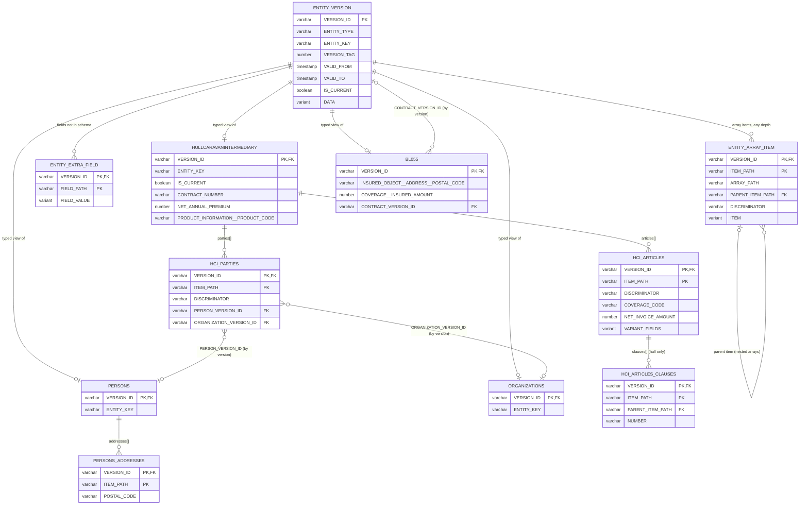

# Part 1 — High-level ERD

Replace the placeholder diagram below with the ERD of your silver model from Q1 (a); gold entities are optional. Readable beats complete: show the main entities, their keys and the relations with cardinalities, and keep it to what fits on one screen. You do not need every table or every column. Any Markdown viewer with Mermaid support renders it (GitHub, VS Code preview, mermaid.live).

Notes on the diagram:
- **Keys.**
  - Every version-level object is keyed on `VERSION_ID`.
  - Every array item is keyed on (`VERSION_ID`, `ITEM_PATH`), e.g. `articles[0].clauses[0]`.
  - Nested items link to their parent through `PARENT_ITEM_PATH`.
  - `sequenceNumber` is not a key because it is sparse.
- **By version, not by entity.** All relations are by `VERSION_ID`, including the `jet://entity` references (snapshot semantics). `ENTITY_KEY` only groups the versions of one entity, for `IS_CURRENT`.
- **Tier 2 shown for one product.** Only the hull-caravan views and the per-variant views that matter here are shown. The per-variant views (e.g. `HCI_ARTICLES__HULL`) have the same key as the union view. The generator-maintained tables `CONFIG_FIELD` and `CODE_LIST` are metadata and are left out of the diagram.
